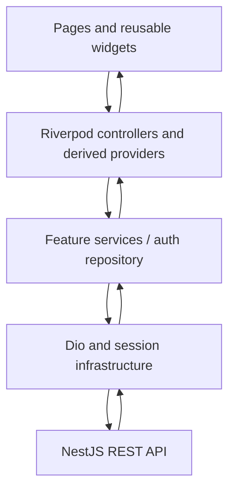

# Frontend architecture

## Technology and design

Flutter 3.41.9 / Dart 3.11.5; Riverpod 3 for state and dependency injection; Dio for REST requests; GoRouter for declarative navigation. The application uses feature-first model/view/controller/service modules rather than putting network calls and business logic in widgets.

```text
lib/
  main.dart                 production entry point
  app.dart                  application root
  app/                      bootstrap, shared shell and branding
  core/                     network, session, config, theme, utilities, shared widgets
  routes/                   routes, router and access policy
  features/
    auth/                   login, registration, logout
    home/                   search, category filters, featured services
    catalog/                shared catalog and service details
    workshop/               configuration, availability, timezone
    booking/                schedule, review, confirmation
    appointments/           shared appointment data and operations
    bookings/               history and detail presentation
    profile/                profile update
    assistant/              AI chat and recommendations
    payments/               checkout and reconciliation
    admin/                  dashboard, categories, services, offers, media,
                            appointments, payments
  demo/                     explicit offline fixtures and entry point
```

## State and data flow



Models parse API DTOs; controllers expose loading/error/success and mutation states. Widgets render state and trigger controller methods. The shared catalog controller supplies service projections including featured services and UUID lookup. Home search matches name, description and category locally. The shared appointments controller owns appointment data; My Bookings derives upcoming/previous views and sort order. Booking and profile mutations invalidate or update the appropriate shared state.

Session-specific controllers watch session identity, discard late asynchronous results after account changes/disposal, and prevent duplicate submissions. Booking availability requests have generation checks; uncertain mutations are not replayed automatically. Core is independent of feature and app code; `scripts/check_architecture.dart` and architecture tests enforce import boundaries.

## Transport and authentication

`core/config/api_config.dart` reads the compile-time API URL. `core/network/dio_provider.dart` constructs shared clients and restricts credential transport to the trusted API origin/path; redirects are disabled. The access token is stored using the token storage abstraction and secure storage on native platforms. Refresh cookies use native persistent cookie transport or browser credentialed cookies. Browser refresh/logout use CSRF protection. A coordinated refresh mechanism avoids parallel refreshes within the client. Route guards distinguish public, customer and admin routes; backend authorization remains authoritative.

## UI and navigation

GoRouter owns route state, and a shared navigation shell adapts the UI to screen size. Shared theme, spacing, buttons, asynchronous state widgets and service cards provide consistency. Booking, payment and AI pages consume typed feature models rather than arbitrary external route URLs. Images use network rendering with fallback states.

## Source and tests

Key files: `lib/core/session/presentation/controller/session_controller.dart`, `lib/features/booking/controller/booking_controller.dart`, `lib/features/catalog/controller/catalog_controller.dart`, `lib/features/assistant/controller/assistant_controller.dart`, `lib/features/payments/controller/payment_controller.dart`, `lib/routes/router_provider.dart`.

`test/` contains architecture, session, network, refresh, booking, payment, admin, assistant, feature flow and responsive UI tests. Screenshot tests are opt-in and use demo fixtures. Run the verification commands in [SETUP.md](SETUP.md).
